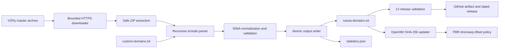
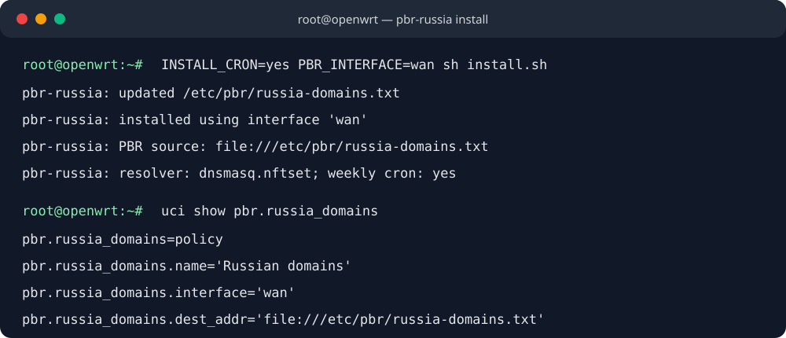
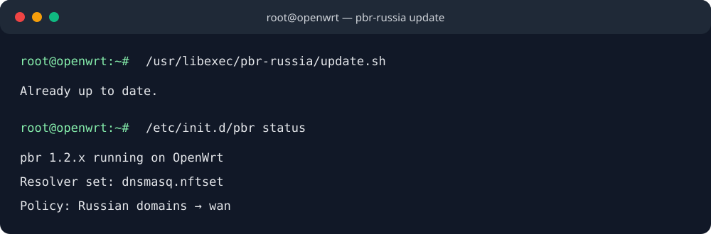

# pbr-russia

[](https://github.com/Aleksan-S/pbr-russia/actions/workflows/update.yml)

An automatically maintained domain list for [OpenWrt Policy Based Routing](https://docs.openwrt.melmac.net/pbr/). The generator downloads the current [`v2fly/domain-list-community`](https://github.com/v2fly/domain-list-community) source, recursively resolves `category-ru`, merges local additions, validates and normalizes every domain, and writes a deterministic PBR-compatible list.

## What is included

`category-ru` is V2Fly's Russian-services aggregation. Resolving it recursively includes its Russian TLD, banking, government, ecommerce, entertainment, medicine, retail, travel, and company lists. `custom-domains.txt` is merged afterward for domains that have not reached upstream.

The parser accepts V2Fly `domain:` and `full:` rules, including the documented prefix-less shorthand for `domain:`. It removes attributes following `@`, ignores `regexp:`, `keyword:`, and unknown rules, converts internationalized names to IDNA, rejects invalid DNS labels, removes duplicates, and sorts the final output.

The generated files are [`output/russia-domains.txt`](output/russia-domains.txt) and [`output/statistics.json`](output/statistics.json). Statistics record the generation timestamp, final domain count, recursively processed includes, removed duplicates, and rejected invalid rules.

## Architecture



`parser.py` owns source download, include resolution, domain normalization, metrics, and atomic text writes. `update.py` orchestrates generation and stable statistics. `validate.py` is an independent release gate. Router integration remains isolated in `openwrt/`.

## Generate locally

Python 3.12 or newer is required.

```sh
python -m venv .venv
. .venv/bin/activate
python -m pip install -r requirements.txt
python update.py
python validate.py output/russia-domains.txt
```

On Windows, activate the environment with `.venv\Scripts\activate`.

Optional CLI arguments:

```text
--entry NAME       Resolve a different/additional V2Fly entry list (repeatable)
--custom PATH      Read local additions from another file
--output PATH      Write to another destination
--statistics PATH  Write statistics to another destination
--archive-url URL  Use another compatible source archive
--log-level LEVEL  DEBUG, INFO, WARNING, or ERROR
```

Add custom entries as bare domains, `domain:example.ru`, or `full:host.example.ru`. Comments and `@attributes` are accepted. Invalid or unsupported entries are logged and skipped.

## OpenWrt installation

The router must have the `pbr` package installed and configured. Run as root:

```sh
uclient-fetch -qO- https://raw.githubusercontent.com/Aleksan-S/pbr-russia/main/openwrt/install.sh | sh
```

The installer is idempotent: it uses the named `pbr.russia_domains` section and updates that section in place. Running it again cannot create a duplicate policy. It:

- downloads the current list to `/etc/pbr/russia-domains.txt`;
- installs the updater at `/usr/libexec/pbr-russia/update.sh`;
- ensures `curl` is installed, as PBR requires it for local `file://` sources;
- creates an idempotent `pbr.russia_domains` policy using `file:///etc/pbr/russia-domains.txt`;
- routes that policy through `wan` by default; and
- verifies that PBR and dnsmasq nftset support are available;
- sets `pbr.config.resolver_set` to `dnsmasq.nftset`; and
- restarts PBR only when the policy configuration or downloaded list changed.

Weekly router updates are opt-in. Set `INSTALL_CRON=yes` to install `30 4 * * 1 /usr/libexec/pbr-russia/update.sh`; the default is `INSTALL_CRON=no`:

```sh
INSTALL_CRON=yes uclient-fetch -qO- https://raw.githubusercontent.com/Aleksan-S/pbr-russia/main/openwrt/install.sh | sh
```

To select another PBR interface, set it during installation:

```sh
PBR_INTERFACE=wg0 uclient-fetch -qO- https://raw.githubusercontent.com/Aleksan-S/pbr-russia/main/openwrt/install.sh | sh
```

Run an immediate update with:

```sh
/usr/libexec/pbr-russia/update.sh
```

The updater validates the download, compares SHA-256 checksums, replaces it atomically only when changed, and restarts PBR only after a changed file. An unchanged run prints `Already up to date.` Environment variables `PBR_RUSSIA_LIST_URL` and `PBR_RUSSIA_TARGET` can override its source and destination.

> The policy interface determines where matching Russian traffic is routed. Confirm that `wan` (or your override) matches your network design before installation.

### OpenWrt screenshots

The following terminal captures illustrate a successful install and an idempotent update. Exact PBR status text varies by package version.





## Automation

The GitHub Actions workflow runs every Monday at 03:00 UTC and can also be started manually. It uses Python 3.12, runs Black, Ruff, and pytest, regenerates both outputs, and independently rejects duplicates, invalid domains, reserved suffixes, or fewer than 1,500 domains. It commits only material changes, uploads a workflow artifact, creates tag `vYYYY.MM.DD`, and attaches `russia-domains.txt` to the GitHub Release.

## Quality checks

```sh
black --check .
ruff check .
pytest
python validate.py
```

The downloader uses HTTPS, bounded downloads, retries, timeouts, archive path validation, and atomic output replacement. Include chains are cycle-checked and limited to 100 levels. Tests cover recursion, cycles, depth limits, attributes, IDNA, duplicates, invalid and empty categories, large outputs, statistics, failed atomic replacement, validation gates, installer idempotency, and changed/unchanged router updates.

## Troubleshooting

| Symptom | Check | Resolution |
| --- | --- | --- |
| Installer reports that PBR is missing | `test -x /etc/init.d/pbr` | Install `pbr` and retry. |
| Installer reports missing nftset support | `dnsmasq --version \| grep nftset` | Replace `dnsmasq` with the OpenWrt `dnsmasq-full` package appropriate for the installed release. |
| Domains do not follow the policy | `uci get pbr.config.resolver_set` | It must print `dnsmasq.nftset`; flush client DNS caches after changing policies. |
| PBR rejects the file URL | `command -v curl` | Install `curl`; PBR uses it for `file://` policy sources. |
| Updater rejects a download | `wc -l /etc/pbr/russia-domains.txt` | Confirm GitHub access and that the remote list contains at least 1,500 valid unique domains. |
| Wrong route is selected | `uci get pbr.russia_domains.interface` | Re-run with the correct `PBR_INTERFACE`, for example `PBR_INTERFACE=wg0`. |

## FAQ

### Why is `category-ru` the entry point?

It is V2Fly's maintained aggregation for Russian sites and recursively includes the service and company categories that belong in this list.

### Why is `example` rejected but `xn--80asehdb` accepted?

Ordinary single-label hostnames are local names rather than Internet domains. A single ASCII label beginning with `xn--` can represent an internationalized top-level domain and is therefore accepted.

### Are `regexp:` and `keyword:` converted?

No. PBR needs concrete domain names, so those rule types and unknown rules are ignored. `domain:`, `full:`, and V2Fly's bare-domain shorthand are supported.

### Will an unchanged install or update interrupt traffic?

No. The installer compares UCI values and the updater compares SHA-256 values. PBR is restarted only if its managed configuration or domain file changed.

### How do I add a domain before V2Fly accepts it?

Add it to `custom-domains.txt`, run `python update.py`, then run `python validate.py` before committing the generated outputs.

## Rollback

To roll back the generated data, download `russia-domains.txt` from an earlier GitHub Release, replace `/etc/pbr/russia-domains.txt`, and restart PBR.

To completely remove this integration while leaving PBR installed:

```sh
uci -q delete pbr.russia_domains
uci commit pbr
sed -i '\|/usr/libexec/pbr-russia/update.sh|d' /etc/crontabs/root
rm -f /etc/pbr/russia-domains.txt
rm -rf /usr/libexec/pbr-russia
/etc/init.d/cron restart
/etc/init.d/pbr restart
```

These commands remove only the named `pbr-russia` policy, its managed list/updater, and its cron entry. Other PBR policies remain intact.

## License

This project is licensed under the [MIT License](LICENSE). The generated domain data originates from V2Fly's domain-list-community project; review its license and source history when redistributing derived data.
