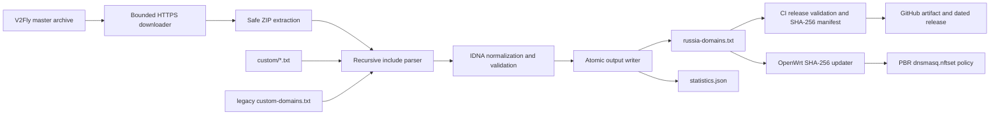

# pbr-russia

[](https://github.com/Aleksan-S/pbr-russia/actions/workflows/update.yml)

An automatically maintained domain list for [OpenWrt Policy Based Routing](https://docs.openwrt.melmac.net/pbr/). The generator downloads the current [`v2fly/domain-list-community`](https://github.com/v2fly/domain-list-community) source, recursively resolves `category-ru`, merges local additions, validates and normalizes every domain, and writes a deterministic PBR-compatible list.

## What is included

`category-ru` is V2Fly's Russian-services aggregation. Resolving it recursively includes its Russian TLD, banking, government, ecommerce, entertainment, medicine, retail, travel, and company lists. Every `custom/*.txt` file is merged afterward for domains that have not reached upstream. The original `custom-domains.txt` is still loaded for backward compatibility.

The parser accepts V2Fly `domain:` and `full:` rules, including the documented prefix-less shorthand for `domain:`. It removes attributes following `@`, ignores `regexp:`, `keyword:`, and unknown rules, converts internationalized names to IDNA, rejects invalid DNS labels, removes duplicates, and sorts the final output.

The generated files are [`output/russia-domains.txt`](output/russia-domains.txt), [`output/statistics.json`](output/statistics.json), and [`output/SHA256SUMS`](output/SHA256SUMS). The checksum manifest also covers the published OpenWrt installer and updater. Statistics record the generation timestamp, final domain count, recursively processed includes, removed duplicates, rejected invalid rules, and the unique domain counts contributed by manual and Smart Home sources.

## Architecture



`parser.py` owns source download, include resolution, domain normalization, metrics, and atomic text writes. `update.py` orchestrates generation and stable statistics. `validate.py` is an independent release gate. Router integration remains isolated in `openwrt/`.

## Generate locally

Python 3.12 or newer is required.

```sh
python -m venv .venv
. .venv/bin/activate
python -m pip install -r requirements.txt
python update.py
python validate.py output/russia-domains.txt
```

On Windows, activate the environment with `.venv\Scripts\activate`.

Optional CLI arguments:

```text
--entry NAME       Resolve a different/additional V2Fly entry list (repeatable)
--custom PATH      Read a legacy customization file from another path
--custom-dir PATH  Read all *.txt customization files from another directory
--output PATH      Write to another destination
--statistics PATH  Write statistics to another destination
--archive-url URL  Use another compatible source archive
--log-level LEVEL  DEBUG, INFO, WARNING, or ERROR
```

Add custom entries as bare domains, `domain:example.ru`, or `full:host.example.ru`. Comments and `@attributes` are accepted. Invalid or unsupported entries are logged and skipped.

### Custom domain files

The generator discovers `*.txt` files directly inside [`custom/`](custom) in filename order; parser changes are not needed when adding a file. Put general additions in [`custom/manual.txt`](custom/manual.txt), or create a focused file such as `custom/my-provider.txt`. Domains are normalized, validated, de-duplicated across every custom file and the legacy file, then merged with V2Fly and sorted.

[`custom/smart-home.txt`](custom/smart-home.txt) contains only verified production service domains, including regional Hik-Connect, EZVIZ, and Xiaomi endpoints observed in dnsmasq queries on a live OpenWrt router. It has no wildcard, URL, IP address, test, or placeholder entries. `smart_home_domains` reports its unique normalized entries. `manual_domains` reports unique entries from all other custom TXT files and `custom-domains.txt`; a domain present in two sources is still emitted only once.

### Supported Smart Home services

The curated list covers these production cloud services:

- Hikvision / Hik-Connect
- EZVIZ
- Xiaomi Home, Mi Home, Mi Account, Xiaomi Cloud, and Mi IoT
- Aqara
- Roborock
- Dreame
- Yeelight
- TP-Link Tapo and TP-Link Kasa
- Home Assistant Cloud (Nabu Casa)
- Eufy Security
- SwitchBot
- Shelly Cloud
- Meross
- Tuya Smart and Smart Life
- Govee
- Nanoleaf
- Philips Hue Cloud
- LG ThinQ
- Samsung SmartThings
- Google Home
- Amazon Alexa
- Apple HomeKit cloud services

The endpoint set is intentionally conservative. Public vendor documentation is used where available—for example [Aqara's regional API hosts](https://docs.aqara.com/docs/aqara-developer/aiot-api/getting-started-with-the-aiot-api), [Tuya's production data centers](https://developer.tuya.com/en/docs/iot/Tuya_Homebridge_Plugin?id=Kamcldj76lhzt), [Google HomeGraph](https://developers.home.google.com/reference/home-graph/rest), [SmartThings](https://developer.smartthings.com/docs/service-integrations/api-overview), [SwitchBot](https://github.com/OpenWonderLabs/SwitchBotAPI), and [Apple service networking](https://support.apple.com/101555). V2Fly's maintained vendor categories and actively maintained integrations provide the evidence for consumer services that do not publish public APIs.

### Discover domains from OpenWrt

[`tools/discover_domains.py`](tools/discover_domains.py) extracts `query[A]` and `query[AAAA]` hostnames from dnsmasq logs, normalizes and de-duplicates them, removes common public-service and shared-infrastructure noise, and prints only names not already present in `output/russia-domains.txt`.

Capture a representative session on the router, then stop it with `Ctrl-C`:

```sh
logread -f | grep dnsmasq > dns.log
```

Copy `dns.log` to the project and inspect it:

```sh
python tools/discover_domains.py --input dns.log
```

The utility also reads stdin when `--input` is omitted:

```sh
python tools/discover_domains.py < dns.log
```

Example report:

```text
Missing domains:

api.example.vendor.com
cloud.vendor.io
mqtt.vendor.net
```

Treat the report as a review queue, not an automatic allowlist. Confirm that each candidate is a production endpoint used by the intended service, add it to `custom/smart-home.txt` or another focused `custom/*.txt` file, then run `python update.py` and `python validate.py`. Shared CDNs and analytics names should not be added unless there is clear service-specific evidence.

## OpenWrt installation

The router must have the `pbr` package installed and configured. Download the latest release manifest and installer, verify SHA-256, and only then run the installer as root:

```sh
(
    set -eu
    release_base=https://github.com/Aleksan-S/pbr-russia/releases/latest/download
    temporary_directory=$(mktemp -d)
    trap 'rm -rf "$temporary_directory"' EXIT HUP INT TERM
    uclient-fetch -q -O "$temporary_directory/SHA256SUMS" "$release_base/SHA256SUMS"
    uclient-fetch -q -O "$temporary_directory/install.sh" "$release_base/install.sh"
    expected=$(awk '$2 == "install.sh" && length($1) == 64 && $1 !~ /[^0-9A-Fa-f]/ { value=tolower($1); matches++ } END { if (matches == 1) print value; else exit 1 }' "$temporary_directory/SHA256SUMS")
    actual=$(sha256sum "$temporary_directory/install.sh" | awk '{print tolower($1)}')
    [ "$actual" = "$expected" ] || { echo "Installer checksum verification failed" >&2; exit 1; }
    sh "$temporary_directory/install.sh"
)
```

The installer is idempotent: it uses the named `pbr.russia_domains` section and updates that section in place. Running it again cannot create a duplicate policy. It:

- downloads the current list to `/etc/pbr/russia-domains.txt`;
- installs the updater at `/usr/libexec/pbr-russia/update.sh`;
- ensures `curl` is installed, as PBR requires it for local `file://` sources;
- creates an idempotent `pbr.russia_domains` policy using `file:///etc/pbr/russia-domains.txt`;
- routes that policy through `wan` by default; and
- verifies that PBR and dnsmasq nftset support are available;
- sets `pbr.config.resolver_set` to `dnsmasq.nftset`; and
- restarts PBR only when the policy configuration or downloaded list changed.

Weekly router updates are opt-in. Set `INSTALL_CRON=yes` on the final `sh` command in the verified installation block to install `30 4 * * 1 /usr/libexec/pbr-russia/update.sh`; the default is `INSTALL_CRON=no`:

```sh
INSTALL_CRON=yes sh "$temporary_directory/install.sh"
```

To select another PBR interface, use the same pattern on the final command:

```sh
PBR_INTERFACE=wg0 sh "$temporary_directory/install.sh"
```

The two short commands above are replacements for the final `sh` line inside the complete verified installation block; they are not standalone commands after the temporary directory has been removed.

Run an immediate update with:

```sh
/usr/libexec/pbr-russia/update.sh
```

The installer verifies `update.sh` against the release manifest before installing it. The updater separately downloads the manifest, verifies `russia-domains.txt`, validates its contents, and replaces the local list atomically only when changed. It restarts PBR only after a changed file; an unchanged run prints `Already up to date.` Environment variables `PBR_RUSSIA_RELEASE_BASE`, `PBR_RUSSIA_LIST_URL`, `PBR_RUSSIA_CHECKSUMS_URL`, and `PBR_RUSSIA_TARGET` can override its release, source, manifest, and destination. A custom list URL must be paired with a checksum manifest that contains exactly one `russia-domains.txt` entry.

> The policy interface determines where matching Russian traffic is routed. Confirm that `wan` (or your override) matches your network design before installation.

### OpenWrt screenshots

The following terminal captures illustrate a successful install and an idempotent update. Exact PBR status text varies by package version.


## Automation

The GitHub Actions workflow runs every Monday at 03:00 UTC and can also be started manually. Every third-party action is pinned to a full commit SHA. A read-only job uses Python 3.12, runs Black, Ruff, pytest, and checksum validation, regenerates the outputs, and independently rejects duplicates, invalid domains, reserved suffixes, or fewer than 1,500 domains. A separate non-PR job receives `contents: write` only for committing material output changes and publishing tag `vYYYY.MM.DD`. If that date already exists, the run and attempt numbers are appended instead of modifying an existing release. Releases contain `install.sh`, `update.sh`, `russia-domains.txt`, `statistics.json`, and `SHA256SUMS`.

## Quality checks

```sh
black --check .
ruff check .
pytest
python validate.py
python tools/generate_checksums.py --check
```

The downloader uses HTTPS, bounded downloads, retries, timeouts, archive path validation, credential-redacted URL logging, and atomic output replacement. Include chains are cycle-checked and limited to 100 levels. Tests cover recursion, cycles, depth limits, attributes, IDNA, duplicates, invalid and empty categories, large outputs, statistics, failed atomic replacement, validation gates, pinned Actions, current release checksums, installer idempotency, checksum failures, and changed/unchanged router updates.

## Troubleshooting

| Symptom | Check | Resolution |
| --- | --- | --- |
| Installer reports that PBR is missing | `test -x /etc/init.d/pbr` | Install `pbr` and retry. |
| Installer reports missing nftset support | `dnsmasq --version \| grep nftset` | Replace `dnsmasq` with the OpenWrt `dnsmasq-full` package appropriate for the installed release. |
| Domains do not follow the policy | `uci get pbr.config.resolver_set` | It must print `dnsmasq.nftset`; flush client DNS caches after changing policies. |
| PBR rejects the file URL | `command -v curl` | Install `curl`; PBR uses it for `file://` policy sources. |
| Updater rejects a checksum | Re-download `SHA256SUMS` and the asset from the same release | Do not install the file; retry later and confirm that both URLs use the same release base. |
| Updater rejects list validation | `wc -l /etc/pbr/russia-domains.txt` | Confirm GitHub access and that the remote list contains at least 1,500 valid unique domains. |
| Wrong route is selected | `uci get pbr.russia_domains.interface` | Re-run with the correct `PBR_INTERFACE`, for example `PBR_INTERFACE=wg0`. |

## FAQ

### Why is `category-ru` the entry point?

It is V2Fly's maintained aggregation for Russian sites and recursively includes the service and company categories that belong in this list.

### Why is `example` rejected but `xn--80asehdb` accepted?

Ordinary single-label hostnames are local names rather than Internet domains. A single ASCII label beginning with `xn--` can represent an internationalized top-level domain and is therefore accepted.

### Are `regexp:` and `keyword:` converted?

No. PBR needs concrete domain names, so those rule types and unknown rules are ignored. `domain:`, `full:`, and V2Fly's bare-domain shorthand are supported.

### Will an unchanged install or update interrupt traffic?

No. The installer compares UCI values and the updater compares SHA-256 values. PBR is restarted only if its managed configuration or domain file changed.

### How do I add a domain before V2Fly accepts it?

Add it to `custom/manual.txt` or create another `custom/*.txt` file, run `python update.py`, then run `python validate.py` before committing the generated outputs. Existing deployments may continue using `custom-domains.txt`.

## Rollback

To roll back the generated data, download `russia-domains.txt` from an earlier GitHub Release, replace `/etc/pbr/russia-domains.txt`, and restart PBR.

To completely remove this integration while leaving PBR installed:

```sh
uci -q delete pbr.russia_domains
uci commit pbr
sed -i '\|/usr/libexec/pbr-russia/update.sh|d' /etc/crontabs/root
rm -f /etc/pbr/russia-domains.txt
rm -rf /usr/libexec/pbr-russia
/etc/init.d/cron restart
/etc/init.d/pbr restart
```

These commands remove only the named `pbr-russia` policy, its managed list/updater, and its cron entry. Other PBR policies remain intact.

## License

This project is licensed under the [MIT License](LICENSE). The generated domain data originates from V2Fly's domain-list-community project; review its license and source history when redistributing derived data.
